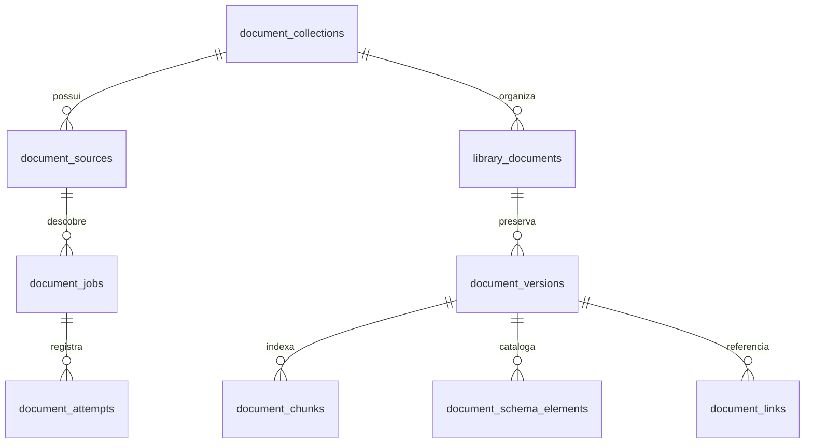

# Biblioteca DOCUMENTOS

Demanda: [AVL-147](https://linear.app/avilaops/issue/AVL-147). O módulo é uma biblioteca de leitura, não um emissor fiscal. Código, extração, indexação e publicação são estados diferentes.

## Decisão de arquitetura

- Next.js e `pg` continuam sendo a aplicação. As migrations `0066_documentos.sql` e `0067_documentos_namespace.sql` usam o runner transacional existente, sem extensão obrigatória ou serviço pago.
- Cada empresa mantém suas coleções no seu schema `tenant_*`. Uma coleção oficial pode ser lida pelos usuários autorizados daquela empresa. Coleções privadas ficam restritas ao proprietário e à Diretoria. Não há biblioteca anônima nem consulta cruzada entre schemas.
- O acervo oficial não é replicado automaticamente para todas as empresas. O administrador cadastra as fontes em cada empresa que precisar delas. O armazenamento físico por SHA-256 permite compartilhar bytes idênticos sem compartilhar permissões. Um acervo SQL global com regras de acesso próprias seria uma evolução, não uma mudança silenciosa do isolamento atual.
- Originais ficam em `ERP_DOCUMENTS_ROOT/sha256/XX/HASH`; extrações JSON e Markdown ficam em `derived/HASH/DERIVED_HASH/`. `ERP_DOCUMENTS_ROOT` precisa ser absoluto e persistente. Os arquivos não entram no Git nem na camada efêmera do container.
- No Postgres ficam coleções, fontes, documentos, versões, chunks por página, catálogo XML, links classificados, jobs e tentativas. Texto usa GIN/FTS português; nome e namespace têm comparação exata; filtros tipados e paginação por relevância e ID. Campo XML exato tem prioridade sobre título e corpo. Versão anterior válida não é substituída por coleta inválida.
- Migrations próprias são código revisado. SQL baixado é documento não confiável e jamais é executado. XSD/XML não é schema SQL, nem a extração de um manual configura tributos na emissão.



O dicionário de campos, checks, FKs e índices está na migration. `library_documents.current_version_id` referencia uma versão do próprio documento por FK composta. Fonte, coleção e job também mantêm integridade por FK composta. URL é única por coleção; hash identifica os bytes, não o título ou a vigência.

## Pipeline

1. `seed` cadastra as quatro raízes fornecidas, de forma idempotente.
2. `run` ou `watch` assume um job com `SKIP LOCKED`, token UUID e lease. Nenhuma transação permanece aberta durante rede ou extração.
3. O downloader valida allowlist, DNS público e TLS, fixa o IP resolvido e verifica cada redirect. Cookies ficam no host de origem. Os caracteres significativos da query são preservados. Links HTTP antigos só são promovidos para HTTPS quando o host já está permitido.
4. O original é guardado e verificado por hash. O extrator roda em processo separado com prazo de 120 s e saída limitada. A imagem de worker também limita RAM/CPU/PIDs e usa filesystem somente leitura, com temporário limitado.
5. PDF textual é extraído por página em layout. Páginas sem texto passam por Tesseract português, usando Poppler ou PDFium para renderização. Método, motor e confiança ficam na extração. Falta de ferramentas ou baixa confiança produz revisão explícita. OCR não substitui o PDF original. Tabelas em texto não se tornam dados tributários automaticamente.
6. ZIP admite até três níveis com orçamento acumulado de expansão e entradas. Caminhos perigosos, symlinks e expansão excessiva são recusados. XML usa parser sem entidades externas; includes/imports viram referências e não são baixados pelo parser. Divergência de encoding é registrada.
7. `.doc` legado exige `antiword`; DOCX, XLS e XLSX têm extração própria. Planilhas são lidas como dados, sem executar macros. Certificados públicos P7B/CER podem ter metadados lidos pelo OpenSSL, sem validação automática de confiança. Formatos não suportados continuam disponíveis como original e ficam sinalizados.
8. Texto e campos XML são gravados em lotes. O token do lease é conferido antes do commit, impedindo gravação por worker que perdeu a posse. O manifesto distingue baixado, indexado, parcial, falho e pendente.

### Limites explícitos

Download: 32 MB; texto por extração: 8 milhões de caracteres; ZIP: 64 MB expandidos e 500 entradas acumuladas; PDF: 1.500 páginas; profundidade de navegação: 12; três tentativas automáticas para falhas transitórias. Limites atingidos geram pendência, nunca sucesso. Não existe promessa de cobertura total com falhas ou exclusões pendentes de revisão.

Datas de publicação e vigência não são inferidas da data de download. Metadados indisponíveis permanecem nulos. A revisão do extrator inclui o hash do derivado: uma extração diferente do mesmo original cria versão própria. A versão interna não substitui a versão normativa declarada pelo órgão. Não foi presumida a existência de anexos SQL nas quatro fontes.

## Desenvolvimento e ingestão isolada

O banco usado nesta tarefa é `erp_documents_test`, com schema `tenant_ludus`, no servidor existente através de túnel local. Credenciais ficam somente em `.work/documents.env`, ignorado pelo Git. A base de produção não recebe migrations por estes comandos.

```powershell
python -m venv .work/documents-venv
.work/documents-venv/Scripts/python.exe -m pip install -r workers/documents/requirements.txt
node scripts/documents-test-environment.mjs
node --env-file=.work/documents.env --experimental-strip-types --import ./scripts/register.mjs scripts/db-migrate.ts
node --env-file=.work/documents.env --experimental-strip-types --import ./scripts/register.mjs scripts/documents.ts seed ludus
node --env-file=.work/documents.env --experimental-strip-types --import ./scripts/register.mjs scripts/documents.ts run ludus 20
node --env-file=.work/documents.env --experimental-strip-types --import ./scripts/register.mjs scripts/documents.ts manifest ludus
node scripts/documents-dev.mjs
```

`documents-test-environment.mjs` cria um papel e banco exclusivos quando ainda não há arquivo local. Se a criação falhar, inspecione o estado remoto antes de repetir; não apague bancos ou papéis preexistentes. O PID do túnel é registrado em `.work/documents-tunnel.pid`. Encerre apenas esse processo ao terminar. O script não é rotina de produção.

Para OCR local, instalar Tesseract com idioma `por`; no Windows a instalação padrão também é detectada. `ERP_DOCUMENTS_TESSDATA` permite indicar um diretório próprio de idiomas. O worker de produção instala Tesseract/Poppler/antiword na imagem. Nenhum executável extraído do corpus é iniciado.

`run` processa um lote e termina. `watch` consulta a fila continuamente e respeita SIGTERM/SIGINT. A fonte pode ter mais de um worker; leases e deduplicação no banco protegem concorrência. Para revisar falhas use `/documentos/coletas`; recolocar na fila não significa processamento concluído.

## API e n8n

`GET /api/v1/documentos/coletas`: resumo e últimas cinco coletas. `POST` no mesmo endereço reenfileira URLs indexadas há mais de 24 horas; retorna 202. Não aceita URL livre e não repete automaticamente bloqueios/falhas. Ambos exigem chave vinculada a usuário ativo da Diretoria com acesso a Documentos; POST exige escrita. É reutilizada a autenticação/rate limit existente. Chaves não vão em URL ou código.

Workflow novo: [Revisitar e supervisionar acervo NF-e](https://n8n.avilaops.com/workflow/qWaAmsIZTR4NZZbl), projeto pessoal **Nicolas Avila**, ID `xeC1Bn8wpAVyjSLU`. Código SDK em `documentos-n8n.workflow.txt`. Está em rascunho, sem credencial atribuída e sem publicação. Os quatro workflows anteriores foram apenas auditados. O teste do rascunho usa pin data e não comprova conectividade com a API real.

Antes de ativar: publicar o ERP e worker, configurar credencial templated com header `Authorization: Bearer` a partir de chave de escrita apropriada, definir timezone `America/Sao_Paulo`, testar requisição real autenticada e obter autorização de publicação. Não preencher um token no nó Code. O fluxo diário enfileira e supervisiona; a extração pesada fica fora do n8n.

## Publicação, backup e rollback

Ainda depende de autorização específica. O container ERP inspecionado não tinha mounts, e o servidor tinha espaço livre reduzido. Não iniciar corpus nele antes de definir capacidade e diretório persistente com proprietário/permissões apropriados.

1. Construir e validar a imagem de worker fora do servidor; não compilar na máquina de produção limitada.
2. Reservar armazenamento persistente e conferir capacidade de banco, originais e derivados. Configurar `ERP_DOCUMENTS_HOST_ROOT`, `ERP_DOCUMENTS_IMAGE` e empresa. Não usar caminho de outro aplicativo.
3. Fazer `pg_dump` do ERP e snapshot/cópia do diretório de blobs, com manifesto de hashes. Testar restauração em banco `_test` e diretório separado antes da mudança.
4. Revisar as migrations 0066/0067, o diff e o estado real de produção. Aplicar pelo runner existente após aprovação. Elas criam tabelas/índices próprios; não reexecutar arquivos SQL coletados. Conferir também migrations anteriores pendentes antes de usar o runner.
5. Copiar `documents.compose.yml` para junto do compose existente em `/opt/erp`; a aplicação monta o volume somente leitura e o worker monta para escrita. O exemplo exige variáveis explícitas; não contém segredo nem presume um volume já criado.
6. Habilitar `ERP_DOCUMENTS_PRODUCTION_APPROVED=1` somente depois do aceite da implantação/ingestão; iniciar fontes e validar um lote antes do contínuo.
7. Para rollback, parar apenas o worker de documentos e retornar a imagem anterior do ERP; preservar tabelas/volume e não apagar acervo. Uma versão anterior do ERP ignora as tabelas novas. Restaurar backup somente com análise do incidente, destino conferido e autorização apropriada.

O backup precisa combinar metadados com originais. Derivados podem ser regenerados; o hash do original deve conferir após restore. Um backup feito depois do dump pode conter blobs extras sem referência; não remova esses blobs automaticamente. Falhas e tentativas são mantidas para auditoria.

O ensaio isolado é reproduzível com `node --env-file=.work/documents.env scripts/documents-backup-verify.mjs`. Ele rejeita bancos de produção, restaura em banco temporário próprio, confere contagens e hashes e remove apenas o banco que acabou de criar. Dump e originais copiados ficam em `.work/documents-backup/`. O relatório de execução está em `docs/evidencias/documentos/backup-verification.json`.

## UX: sete respostas

1. A tarefa principal é buscar um documento; leitura, fonte, versões, campos e coletas têm destinos próprios.
2. Título e estado aparecem na lista; detalhes longos ficam em Fonte. O texto é leitura em região rolável com foco, sem recorte do original.
3. Buscar é a ação principal; todos os filtros são aplicados por uma única ação.
4. Os cinco tamanhos são medidos por `tests/visual/documentos.spec.ts`; resultados ficam em `test-results/documentos/medidas.json`.
5. Coleção/formato, categoria/estado e período/versão ficam juntos na página de Filtros. Conteúdo longo tem trechos e região de leitura com rolagem explícita.
6. Busca e filtros permanecem na URL; paginação keyset preserva os valores. Versões são endereçáveis.
7. Controles nativos, foco visível, regiões de leitura acessíveis por teclado e componentes compartilhados. O teste adicional verifica teclado, texto ampliado a 200%, sessão obrigatória e hash do download.

## Verificação

```powershell
.work/documents-venv/Scripts/python.exe -m unittest discover -s workers/documents -p 'test_*.py'
node --env-file=.work/documents.env --experimental-strip-types --import ./tests/register.mjs --test --test-concurrency=1 tests/documents.test.ts tests/db-documents.test.ts
node node_modules/@playwright/test/cli.js test tests/visual/documentos.spec.ts --workers=1
node --env-file=.work/documents.env --experimental-strip-types --import ./scripts/register.mjs scripts/documents-benchmark.ts 10000
npm run lint
npm run typecheck
npm run build
```

O benchmark usa schema temporário próprio, declara volume e concorrência e o remove ao terminar. Separa tempo no cliente/túnel de `Execution Time` do PostgreSQL, medido com `EXPLAIN (ANALYZE, BUFFERS)`. Não execute o benchmark em banco de produção. Métricas não equivalem a SLA nem a medição de renderização.
